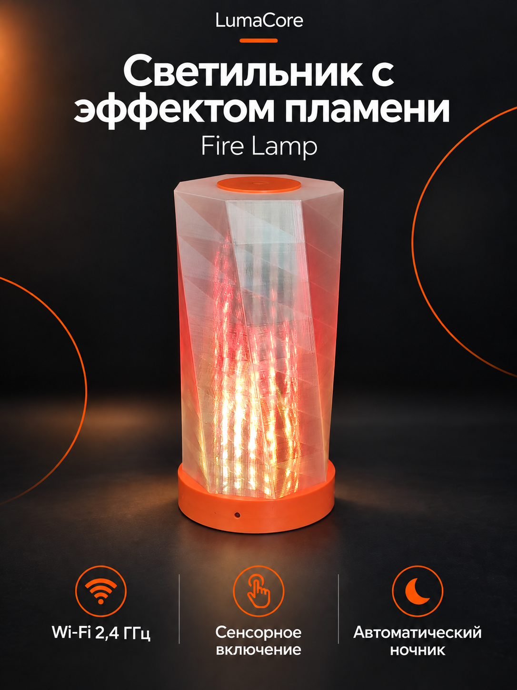
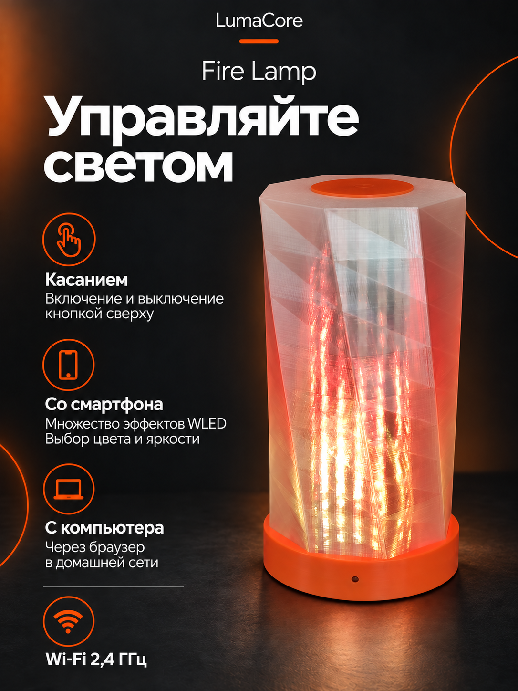
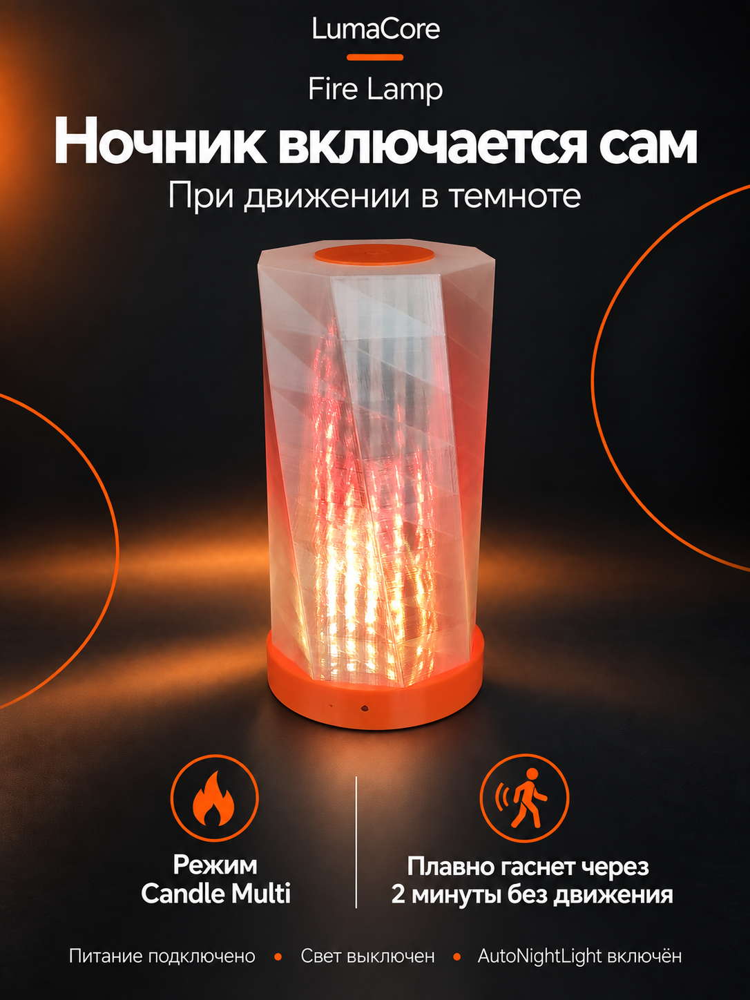
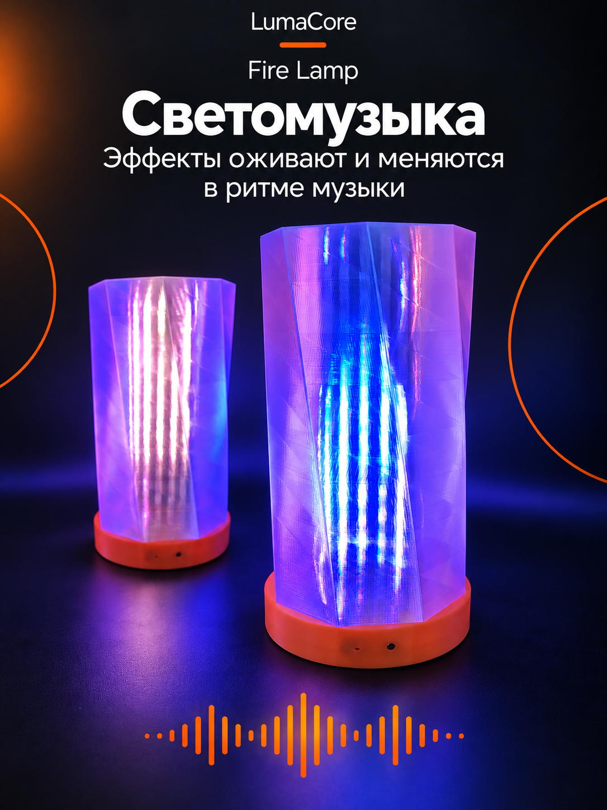
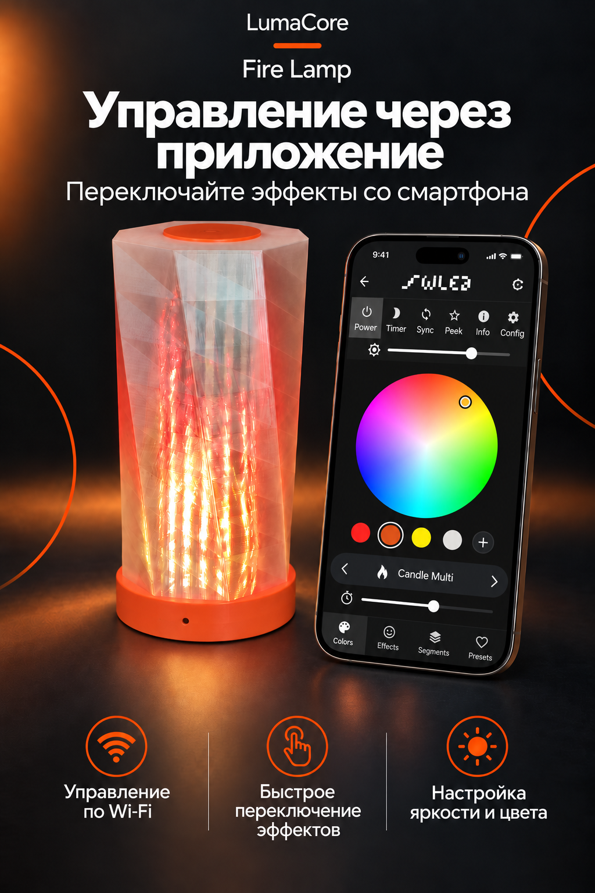
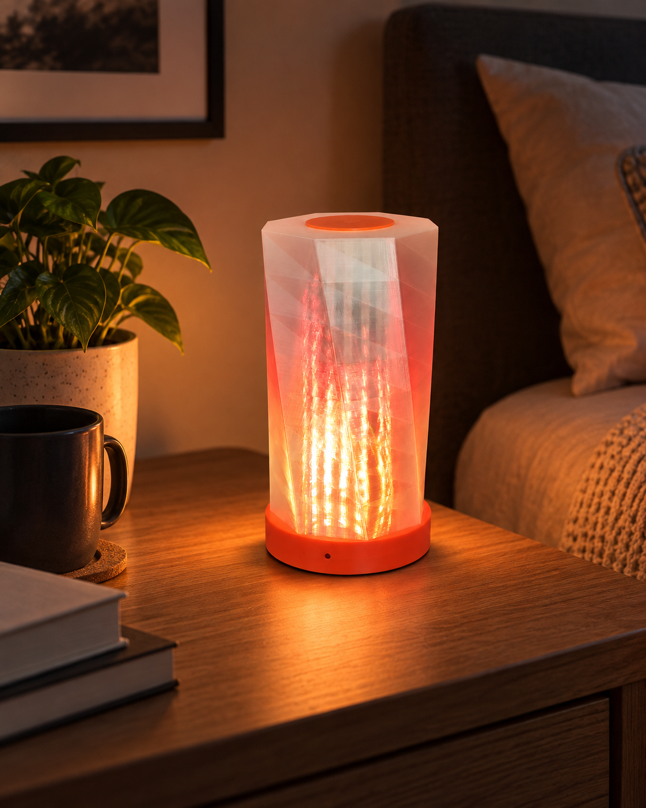
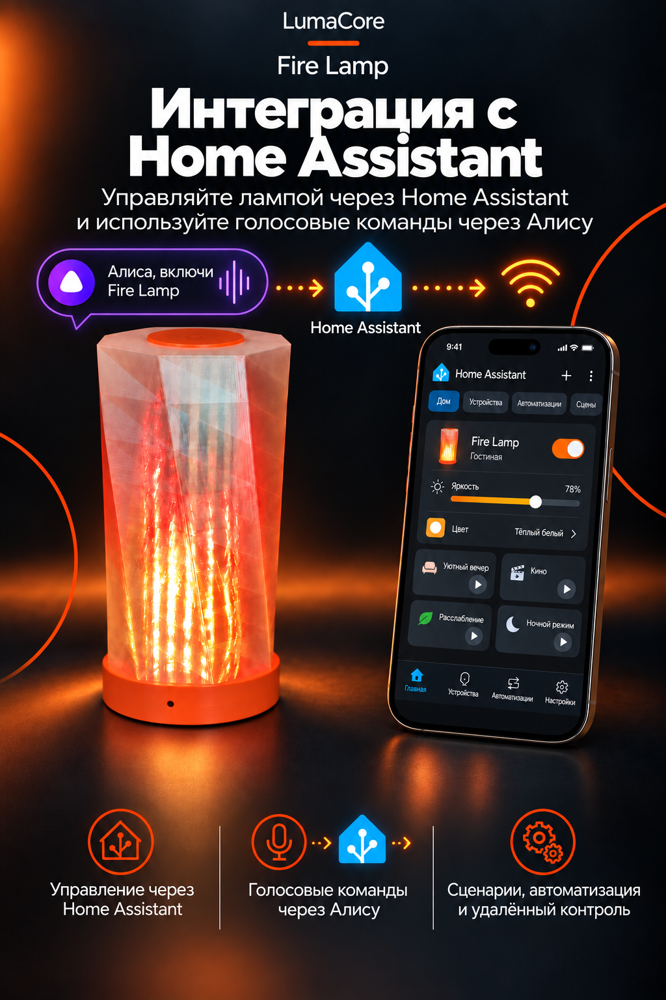

# Fire Lamp

Fire Lamp — настольный адресный LED-светильник с контроллером на ESP32-S3, матрицей WS2812B 16×16 и прошивкой на базе WLED.

Проект объединяет механику, электронику и встроенное ПО в одном изделии.

## Проверка платы с C14 100 мкФ

В текущем [наборе PCB](pcb/) C14 заменён на 100 мкФ / 16 В (`EEE-FT1C101AR`, корпус 5 × 5,8 мм) и установлен во всех вариантах сборки. 4 ноября 2026 года владелец подтвердил: плата с C14 100 мкФ проверена, всё работает без сбоев.

В прежней конфигурации несколько раз наблюдались перезапуски ESP32-S3 при включении питания LED-матрицы после долгого выключения. Пусковой ток рассматривался как возможная причина, но электрическими измерениями она не установлена. Условия и длительность новой проверки не указаны; результат относится к проверенному прототипу.

## Основные узлы

- ESP32-S3;
- адресная LED-матрица WS2812B 16×16, 256 светодиодов;
- контроллер LumaCore-S3-PWR;
- PIR-датчик движения;
- датчик освещённости BH1750;
- питание 5 В;
- WLED с пользовательским модулем автоматического ночного режима.

## Структура

- [cad](cad/) — открытая механическая модель в формате STEP;
- [pcb](pcb/) — схема и печатная плата контроллера;
- [firmware](firmware/) — пользовательский модуль WLED и конфигурация;
- [docs](docs/) — архитектура и описание инженерных решений.

## Архитектура

```text
                         Fire Lamp
                             │
              ┌──────────────┼──────────────┐
              │              │              │
              ▼              ▼              ▼
           Корпус         LED 16×16     Датчики
              │              │          PIR + BH1750
              │              │              │
              └──────────────┼──────────────┘
                             ▼
                     LumaCore-S3-PWR
                             │
                             ▼
                         ESP32-S3
                             │
                             ▼
                       WLED + usermod
```

## Что демонстрирует проект

Проект охватывает полный цикл разработки небольшого электронного изделия:

- механическая компоновка и CAD;
- интеграция платы, матрицы и датчиков в корпус;
- разработка принципиальной схемы;
- разводка PCB;
- силовое питание адресных светодиодов;
- разработка встроенного ПО;
- интеграция датчиков;
- настройка сценариев автоматического управления;
- прототипирование и проверка работы устройства.

## Механическая модель

- [Сборка Fire Lamp R1.2 в формате STEP](cad/fire-lamp-assembly.step)

## Галерея

Изображения Fire Lamp. Нажмите на изображение, чтобы открыть оригинал.

| | |
| --- | --- |
| [](media/images/1.png) | [](media/images/2.png) |
| [](media/images/3.png) | [](media/images/4.png) |
| [](media/images/5.png) | [](media/images/6.png) |
| [](media/images/7.png) | [](media/images/8.png) |

## Видео

- [Видео history.mp4](media/video/history.mp4)
- [Демонстрация работы Fire Lamp](media/video/VID_20260911_115708.mp4)

## Состояние публикации

Публичная версия содержит только материалы, предназначенные для открытого использования. Нативные CAD-файлы КОМПАС-3D и внутренние рабочие материалы не публикуются.
