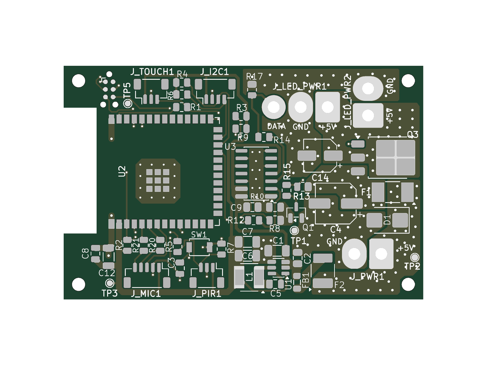
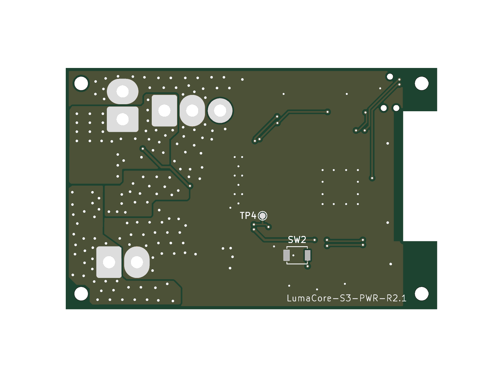

# PCB — LumaCore-S3-PWR

Электроника Fire Lamp построена на контроллере LumaCore-S3-PWR.

## Рендеры платы

### Верхняя сторона

### Нижняя сторона

## Исходники

В каталоге `source/` находятся исходники KiCad:

- проект;
- принципиальная схема;
- печатная плата.

Используемые проектом символы, посадочные места и модели компонентов находятся в `source/lib/`. Таблицы `sym-lib-table` и `fp-lib-table` используют относительные пути. Для открытия проекта установите KiCad 10 со стандартными библиотеками и откройте `source/LumaCore-S3-PWR.kicad_pro`.

В каталоге `production/` размещены открытые производственные данные, которые можно использовать для анализа платы и подготовки сборки.

## Проверки опубликованного набора

Исходники, BOM, координаты и рендеры обновлены 4 ноября 2026 года. ERC и DRC выполнены повторно именно для опубликованной структуры каталогов в KiCad 10.0.8:

- ERC: 0 ошибок и предупреждений;
- DRC с перезаливкой зон и проверкой соответствия схеме: 0 нарушений, 0 неподключённых элементов, 0 расхождений;
- C4 и C14 указаны отдельными строками BOM; C14 100 мкФ присутствует в координатах установки.

Отчёты сохранены в `production/`. Эти проверки и подтверждение работы прототипа не являются квалификацией серийного производства, испытанием на 8 А или подтверждением тепловых пределов.

## Основные параметры

- MCU: ESP32-S3-WROOM-1;
- питание изделия: 5 В;
- нагрузка: WS2812B 16×16;
- LED DATA: отдельный буферизированный цифровой выход;
- управление питанием LED;
- отдельное питание логики 3,3 В.

## Ревизия

Опубликованный набор PCB основан на LumaCore-S3-PWR R2.1.

Плата является частью проекта Fire Lamp, но может использоваться и как самостоятельная аппаратная платформа.
