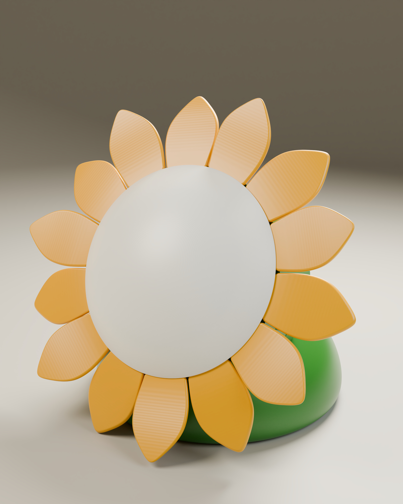
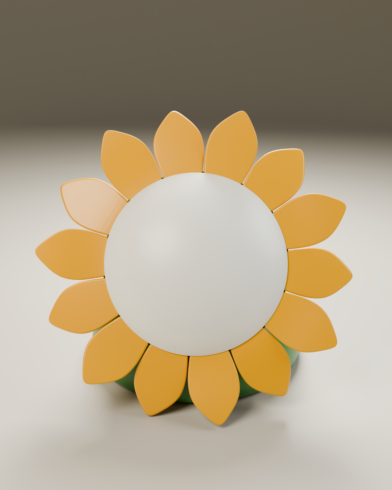
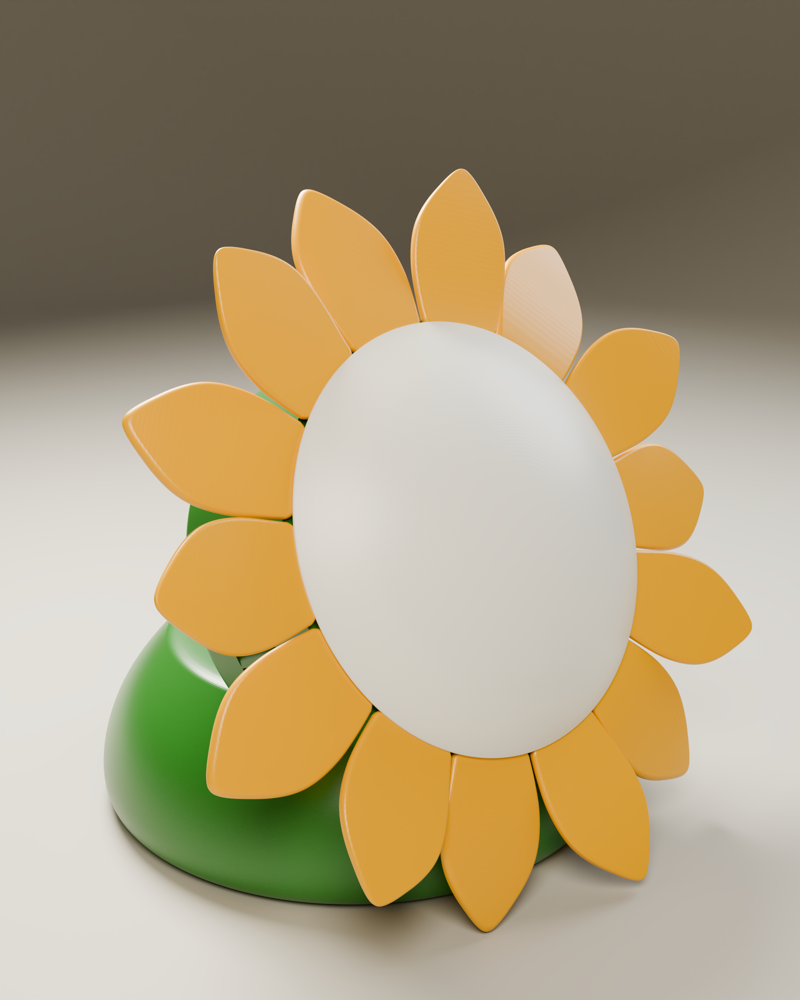
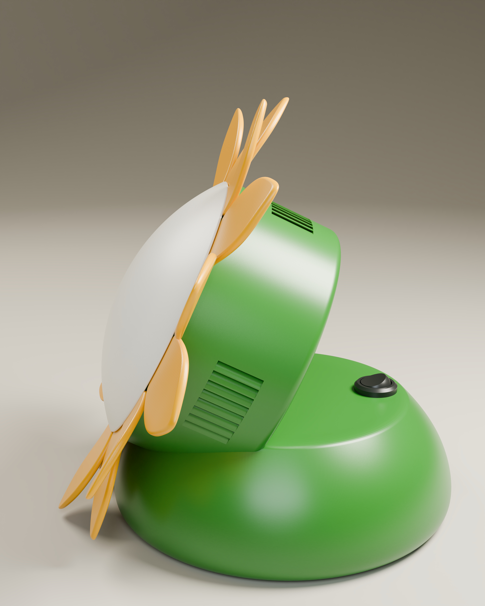
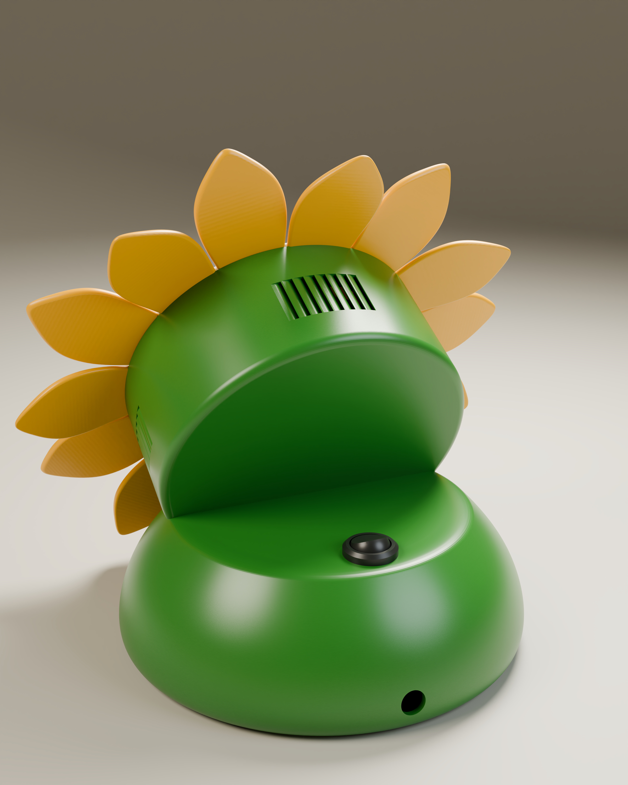
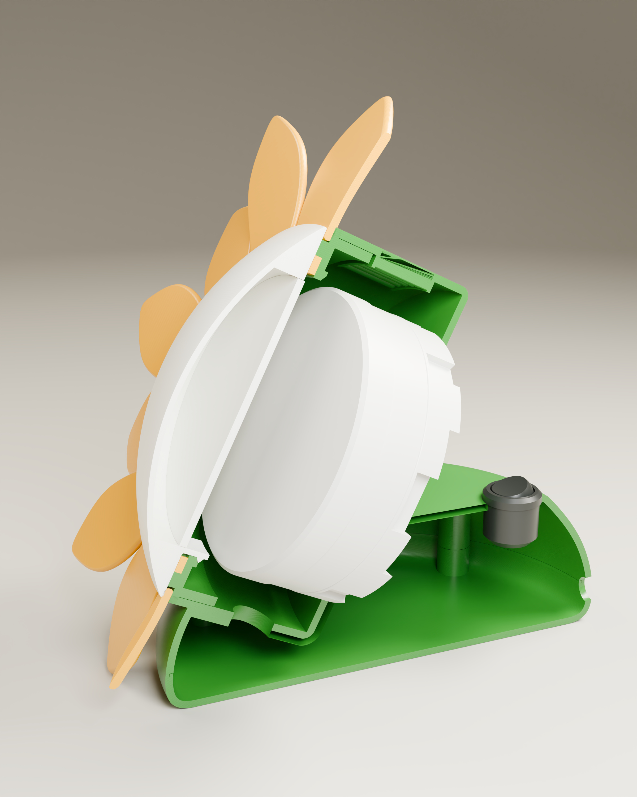
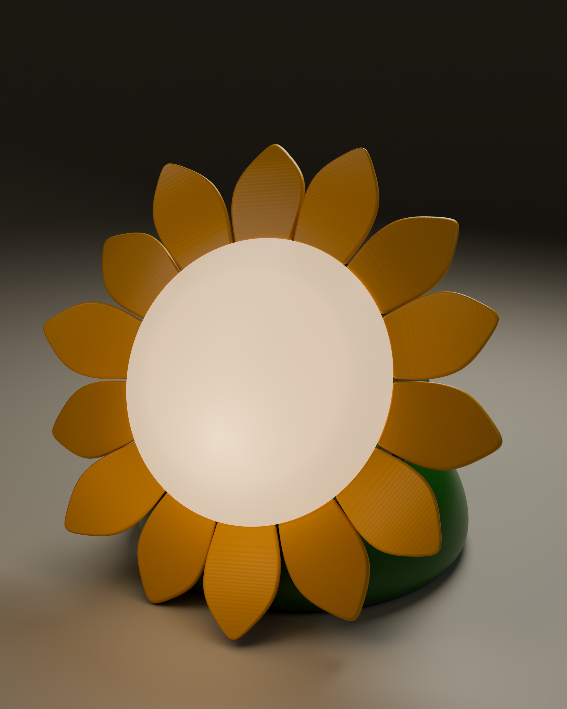
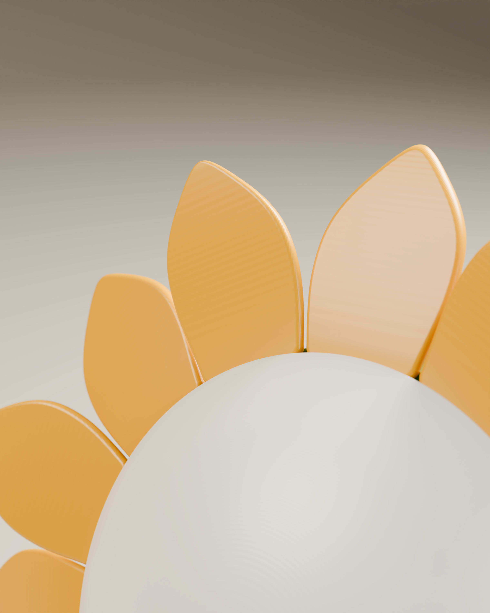

# Подсолнух / Sunflower

«Подсолнух» — настольный ночник в форме цветка с корпусом и плафоном для 3D-печати, сменной лампой GX53 и покупным патроном.
Проект объединяет разработку формы, механическую компоновку, CAD и подготовку деталей к FDM-печати.

## Основные узлы

- печатное основание из двух частей;
- корпус с вентиляционными отверстиями;
- составной плафон, рассеиватель и декоративные лепестки;
- патрон GX53LPECB Ecola;
- одна лампа на выбор: YNDX-00556 с управлением через Алису либо матовая Ecola Premium GX53, 6 Вт, 2800 К (тёплый белый);
- круглый чёрный выключатель 2pin, 3 А / 250 В, наружный диаметр 16 мм и посадочный диаметр 15 мм;
- латунные резьбовые вставки и винты M3.

Управление через Алису относится к варианту с YNDX-00556. Собственная электроника управления и прошивка для этого варианта не требуются.

## Файлы проекта

| Раздел | Содержимое |
| --- | --- |
| [CAD](cad/) | Справочная сборка STEP и описание её ограничений |
| [Файлы для 3D-печати](3d-printing/) | Семь STL, проект 3MF и сохранённые параметры печати |
| [BOM](docs/BOM.md) | Печатные детали, покупные компоненты и крепёж |
| [Конструкция](docs/DESIGN.md) | Компоновка и особенности разработки |
| [Сборка](docs/ASSEMBLY.md) | Подготовка и порядок механической сборки |
| [Медиа](media/) | Галерея визуализаций и короткое видео |

## Что демонстрирует проект

- разработку предметной формы и декоративных элементов;
- компоновку стандартной лампы и патрона в печатном корпусе;
- разделение изделия на детали для FDM-печати;
- применение резьбовых вставок и разъёмного крепления;
- подготовку проекта печати с несколькими материалами/цветами;
- визуализацию внешнего вида и внутреннего устройства.

## Механическая модель и печать

- [Скачать справочную сборку STEP](cad/sunflower-assembly.step).
- [Файлы для 3D-печати: STL, 3MF и параметры](3d-printing/README.md).
- [Скачать проект Bambu Studio 3MF](3d-printing/sunflower.3mf).
- [Перечень деталей и компонентов](docs/BOM.md).

Для изготовления используйте комплект STL/3MF. STEP опубликован для просмотра компоновки: геометрия верхней части подставки и верхней части плафона отличается от подготовленных файлов печати. Подробности приведены в [описании CAD](cad/README.md).

## Галерея

Все изображения ниже — компьютерные визуализации. Нажмите на изображение, чтобы открыть оригинал.

| | |
| --- | --- |
|  |  |
|  |  |
|  |  |
|  |  |

## Видео

[Короткая визуализация «Подсолнуха»](media/video/sunflower.mp4) — 15 секунд, 1080 × 1920, без звуковой дорожки.

## Состояние публикации

Опубликованы материалы конструкции, файлы печати, BOM и визуализации. Параметры в 3MF отражают сохранённый рабочий профиль; результаты физической печати, тепловых испытаний и работы конкретной сборки в этой публикации не документированы.

В комплекте печати есть семь типов деталей. В STEP расположено 14 лепестков, а в 3MF на столе размещено 15 экземпляров. Модель кнопки показана в CAD; характеристики покупного выключателя и сведения о комплектации сетевого шнура приведены в BOM.

Нативные CAD-файлы, Blender-сцены, архивы рабочих версий, сканы, каталоги поставщиков и PDF-спецификация в публичный комплект не включены.
