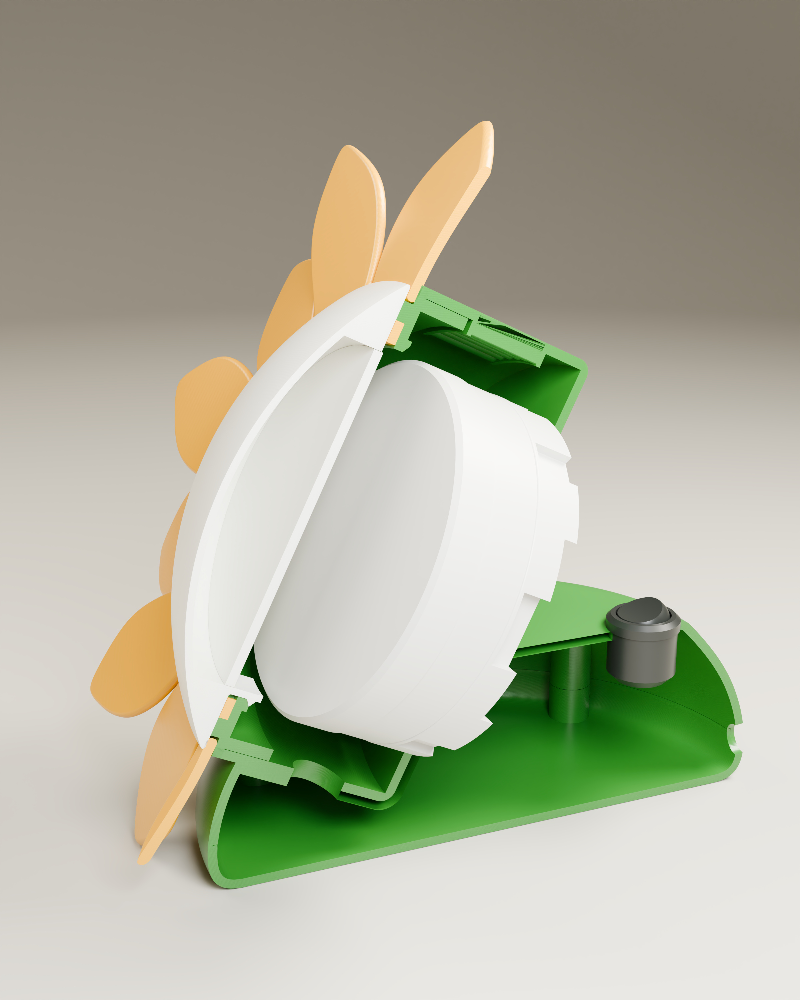

# Конструкция ночника «Подсолнух»

## Идея

Передняя часть ночника выполнена в виде цветка: центральный плафон окружён отдельными лепестками, корпус и основание образуют опору. Разделение на детали позволяет печатать элементы разными цветами и собирать изделие с покупным источником света.

## Компоновка

| Узел | Назначение |
| --- | --- |
| Основание из двух частей | Опора и доступ к внутренней части |
| Корпус | Размещение узлов и соединение с плафоном |
| Вентиляционные отверстия | Предусмотренные в конструкции отверстия корпуса |
| Плафон и рассеиватель | Формирование центральной светящейся части |
| Отдельные лепестки | Декоративный контур цветка |
| Патрон GX53 | Установка сменной лампы |
| Вставки и винты M3 | Разъёмное крепление частей |

## Источник света и управление

Предусмотрены два варианта лампы: YNDX-00556 с управлением через Алису либо GX53 Ecola. В обоих случаях требуется одна лампа. Вариант с Алисой использует возможности покупной лампы; проект не содержит собственного контроллера или прошивки.

## Подготовка к изготовлению

Рабочий проект 3MF содержит семь столов и назначение трёх цветов PETG. Разделение на корпус, основание, части плафона, рассеиватель и отдельный лепесток сохранено в публичных STL.

Механическая компоновка STEP и подготовленные сетки имеют различия, описанные в [CAD](../cad/README.md). Для изготовления опубликован набор STL/3MF; STEP предназначен для изучения расположения узлов.

## Границы подтверждённых данных

Сохранённые параметры печати и цифровая модель доступны для изучения. Материалы публикации не содержат протоколов физических испытаний, подтверждённого температурного режима или электрической схемы готового изделия. Галерея и видео показывают визуализации.
